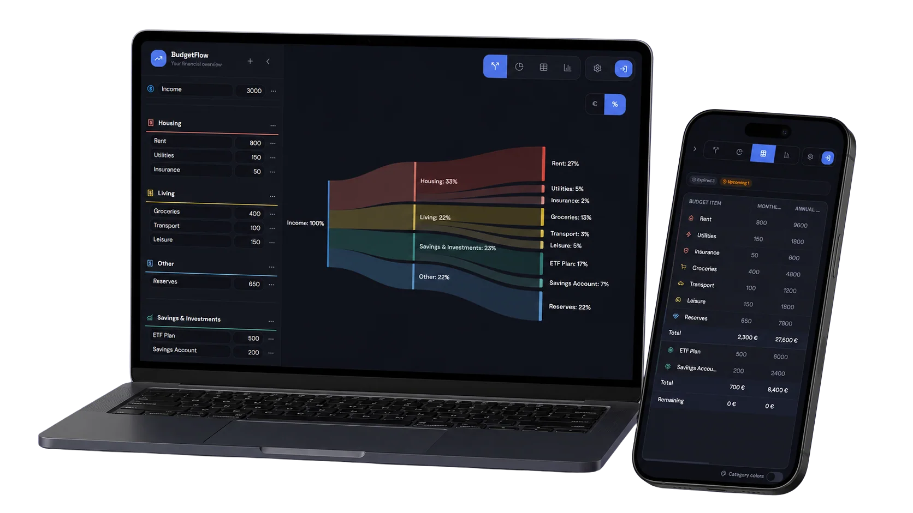
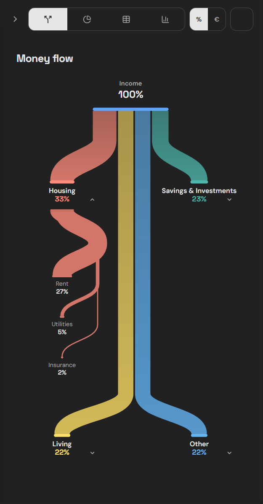

# BudgetFlow

<p align="center">
  
  
  
  
</p>

> A modern, self-hosted personal finance visualization application that helps you understand where your money goes through beautiful, intuitive charts.

<p align="center"><a href="https://budget-kinan.vercel.app/">Try the live demo</a></p>

<p align="center">
  
</p>

---

## Features

### Interactive Charts
- **Sankey flow** - Follow income through expense and investment categories to individual items; the layout adapts for mobile screens.
- **Donut chart** - Compare expense and investment categories at a glance.
- **Table view** - Review and edit budget items with monthly and annual amounts, percentages of income, dates, and category totals.

<p align="center">
  
</p>

### Spending and investment analysis
- Compare income and remaining budget with spending and investment totals.
- Break expenses and investments down by category; expand investment categories to see individual contributions.
- Switch between monthly and annual totals, or show amounts as percentages of income.
- Explore an investment forecast from starting capital and current monthly investment contributions, using an assumed annual rate, time horizon, and monthly or annual compounding. The projection also shows savings from the remaining monthly budget separately.

### Budget planning
- Edit multiple income sources, expense and investment categories, and their items. Reorder entries and customize category colors.
- Track start and end dates, cancellation dates, notice periods, and notes for budget items.
- See upcoming, urgent, and expired cancellation deadlines in the table. The charts also highlight when planned outflows exceed income.

### Settings and data
- Choose from multiple currencies and light or dark appearance.
- Import and export CSV files; export and restore JSON backups.
- Save data locally in a browser or sync to the SQLite database in a self-hosted deployment.
- Self-hosted Docker deployments require sign-in by default. The public Vercel demo needs no account and stores data in each visitor's browser.

---

## Self-Hosting

The recommended way to run BudgetFlow is using Docker Compose. Since the project is configured with GitHub Actions, pre-built Docker images are automatically published to the GitHub Container Registry (GHCR).

### Quick Start with Docker Compose

1. Create a directory for BudgetFlow and navigate into it:
   ```bash
   mkdir -p budgetflow && cd budgetflow
   ```

2. Create a `docker-compose.yml` file:
   ```yaml
   services:
     budgetflow:
       image: ghcr.io/kinanqazan/budget-flow:latest
       container_name: budgetflow
       ports:
         - "3000:3000"
       volumes:
         - budgetflow-data:/app/data
       environment:
         - PORT=3000
         - HOST=0.0.0.0
         - DATA_DIR=/app/data
         - JWT_SECRET=your-secure-random-string # Generate a long secure secret for login security
         - AUTH_ENABLED=true                     # Keep true for deployed instances
       restart: unless-stopped

   volumes:
     budgetflow-data:
   ```

3. Start the container in the background:
   ```bash
   docker compose up -d
   ```

4. Open your web browser and go to `http://<YOUR_SERVER_IP>:3000`. The first visit guides you through creating the single account for this instance. Later visits require signing in before showing your budget.

---

### Configuration Options

| Variable | Default | Description |
|----------|---------|-------------|
| `PORT` | `3000` | Server port inside the container |
| `HOST` | `0.0.0.0` | Host binding for server socket |
| `DATA_DIR` | `/app/data` | Directory where the SQLite database is stored |
| `JWT_SECRET` | - | Secret key used to sign session tokens. Automatically generated at startup if missing. |
| `JWT_EXPIRES_IN` | `7d` | Token expiration time |
| `AUTH_ENABLED` | `true` in Docker | Enable/disable authentication. Docker images enable it by default. Set it to `false` only for a trusted local preview without sign-in. |
| `LOG_LEVEL` | `info` | Server log level (`debug`, `info`, `warn`, `error`) |

---

### Updating the Application

Since your image is hosted on GitHub Packages, updates are lightweight and instant:

1. Navigate to your app directory:
   ```bash
   cd budgetflow
   ```

2. Pull the latest image and restart the container:
   ```bash
   docker compose pull
   docker compose up -d
   ```

---

## Development

### Prerequisites
- Node.js 18+
- npm or bun

### Setup

```bash
# Install dependencies
npm install

# Copy environment file
cp .env.example .env
# Edit .env and set JWT_SECRET

# Run development server
npm run dev
```

### Personal Hermes assistant

BudgetFlow includes an optional local MCP adapter for reading budgets and creating, editing or deleting categories and entries. It uses a dedicated token and protects browser/assistant changes with revisions. Assistant access is disabled until configured. See [connection and verification instructions](integrations/hermes-mcp/README.md).

### Tech Stack

| Technology | Purpose |
|------------|---------|
| React | UI framework |
| TypeScript | Type safety |
| Vite | Build tool & dev server |
| Tailwind CSS | Styling |
| shadcn/ui | UI components |
| Fastify | Backend API |
| SQLite | Database |
| Docker | Self-hosting |

---

## License

MIT License - Feel free to use, modify, and distribute.

---

Built with ❤️ by Kinan
