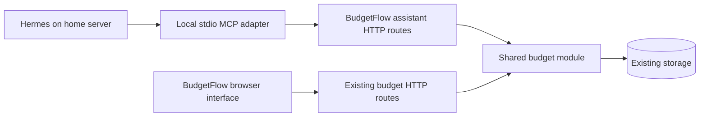

# BudgetFlow: personal Hermes integration

Status: repository implementation completed 2026-10-08. Local backend, browser synchronization, and MCP round-trip checks are implemented. Live home-server deployment and Hermes configuration remain pending connection details. See `integrations/hermes-mcp/README.md`.

## Outcome and chosen approach

Hermes can read the saved budget, create categories and zero-value placeholders, edit income and expense/investment entries, and remove entries. Changes persist in BudgetFlow and appear in its interface.

Use a small local **stdio MCP adapter**, started by Hermes, which calls authenticated HTTP operations in BudgetFlow's existing Fastify backend. Use the official Python MCP SDK in an isolated virtual environment alongside Hermes. Pin a compatible SDK version during implementation and test against the installed Hermes version.



The backend owns validation, mutations, and persistence. The adapter owns tool descriptions, input schemas, HTTP calls, and error translation. It has no database access and implements no second copy of budget calculations or mutation rules.

Scope is one personal installation and its existing account. Existing app login remains in use for the browser. Agent access uses one dedicated token. OAuth, a public MCP endpoint, token-management screens, multiple workspaces, arbitrary SQL/shell tools, and a new assistant chat UI are outside this implementation. Hermes reads saved data; unsaved browser drafts are not exposed.

## Current code that this extends

| File | Relevant behavior |
| --- | --- |
| `server/routes/budget.ts` | `GET /api/budget` reads the budget; `PUT /api/budget` replaces the complete budget and display preferences. |
| `server/middleware/auth.ts` | Browser requests use JWT authentication when enabled, or the `default` account in preview mode. |
| `server/db/schema.ts` | One budget row per user; stored JSON, preferences, and a timestamp; no revision column. |
| `server/db/mock-db.ts` | JSON storage fallback with its own supported query implementations. |
| `src/hooks/useFinanceData.ts` | Browser loads once, edits local state, and autosaves a complete snapshot after two seconds. |
| `src/lib/api.ts` | Existing HTTP wrapper retries all errors, including client errors. |
| `src/types/finance.ts` | Income entries, categories, expense/investment items, and existing item metadata. |

Two behaviors must change before enabling assistant writes:

1. Browser and assistant saves need a common revision check to prevent old snapshots overwriting newer edits.
2. The server and browser currently consider budgets without categories or positive income to be missing data. Empty and zero-value budgets must remain valid, especially when creating placeholders or deleting the last entry.

## Public tool interface

Expose seven tools. Tool names describe user actions; no generic code-execution tool is needed.

| Tool | Inputs and behavior |
| --- | --- |
| `read_budget` | Return the complete saved snapshot: revision, initialization state, currency, income, categories, item metadata, and totals using the app's current amount semantics. Include stable IDs and an explanation that investment items live in categories with `type: investment`. |
| `create_category` | Name, expense/investment type, optional color, expected revision. Create an empty category; default its color consistently with the app. |
| `update_category` | Category ID, changed name/color/type fields, expected revision. Preserve entries and unspecified fields. |
| `delete_category` | Category ID and expected revision. Allow deletion only when empty; return a clear error for a populated category. |
| `create_entry` | Kind (`income` or `item`), name, value defaulting to zero, category ID for items, optional existing item metadata, expected revision. Append an entry to the chosen location. |
| `update_entry` | Kind, entry ID, category ID for items, allowed changed fields, expected revision. Preserve IDs, ordering, and unspecified metadata. |
| `delete_entry` | Kind, entry ID, category ID for items, expected revision. Remove exactly that entry. |

An item is an expense or investment according to its category. Income entries permit name/value changes; items also permit the metadata already defined in `ExpenseItem`. Explicit null clears optional metadata; omission preserves it. Moving entries between categories and reordering remain available in the existing UI and can be added as tools later if needed.

Names are labels, not identifiers. Tool descriptions instruct Hermes to read first, select IDs, and clarify ambiguous requests. Creating two intentionally identical labels is allowed. Backend schemas reject invalid IDs, non-finite or negative new amounts, invalid category types, invalid metadata, and unknown fields. Preserve legacy stored records on reads; report records that cannot be safely changed rather than silently repairing them.

Mutations return the affected record/ID and the authoritative new snapshot and revision. Tool errors distinguish invalid input, unknown record, unauthorized access, revision conflict, unavailable server, and uncertain write outcome. Read and mutation annotations must accurately describe their effects; annotations do not replace backend checks.

## Backend interface and authentication

Add two assistant-only routes:

- `GET /api/assistant/budget`
- `POST /api/assistant/actions`

The action route accepts a discriminated union of the six mutation operations above, with a mandatory `expected_revision`. Each MCP tool maps to one action; Hermes does not send arbitrary endpoints or raw budget replacements.

Configure a random, dedicated `ASSISTANT_API_TOKEN` through the app's environment. The adapter reads the same value as `BUDGETFLOW_API_TOKEN` from Hermes's secret environment and sends it in the Authorization bearer header. Compare credential digests in constant time and redact authorization headers from logs. Reject missing, empty, or unresolved placeholder credentials during adapter startup.

The dedicated token is valid only for assistant routes. It grants access to budget content, not login, account deletion, or arbitrary server operations. Assistant routes require it even when browser authentication is disabled. Missing server configuration disables assistant access by default. Rotating/removing the token and restarting BudgetFlow revokes it; reconnect/restart the adapter after changing its credential.

Resolve the sole account on the server; never accept an account ID from Hermes. With authentication enabled, fail closed if setup is incomplete or the database has an ambiguous account state. In preview mode, use the existing `default` account. Rotate the assistant token when resetting/recreating the installation's account.

Use a verified HTTPS connection when requests cross a machine/network boundary. A loopback or explicitly isolated container-network connection can use HTTP. Document that `localhost` inside a Hermes container refers to that container, and configure the reachable BudgetFlow URL accordingly. No public exposure is required.

## Shared budget module and revision contract

Introduce a backend budget module with a small interface for reading a snapshot, applying an action, and saving a browser snapshot. Both route families call it. Hide account lookup, persistence, validation, ID generation rules, default handling, totals, and revision errors behind this interface.

Add an integer `revision` to stored budgets with an idempotent migration preserving existing JSON and preferences. Read revision zero when no budget exists; the first accepted save creates revision one. Every accepted write increments the revision and checks the client's expected revision atomically. Use conditional updates and checked affected-row counts; handle first-row creation races explicitly. Timestamps remain informational and are not used as revisions.

Update browser GET/PUT contracts to carry revisions. Browser PUT also requires an expected revision. Missing preconditions return 428; a stale revision returns 409 without changing storage. Ship browser/backend changes together; older cached clients must refresh rather than retain an unguarded save path.

Distinguish a never-initialized budget from a saved empty budget. The UI can show its sample defaults only before initialization. Assistant create operations on a never-initialized budget begin with empty income/categories, not invented sample financial values. An explicit empty or all-zero budget survives save, load, restart, and export/import.

Assistant edits preserve currency, theme, display colors, unrelated entries, and metadata. Use existing stored amount/billing semantics; do not silently convert annual amounts or introduce new financial calculations. Extract/reuse the current totals calculation so the interface and assistant do not drift.

Mirror the revision and conditional-write contract in the JSON fallback. Surface persistence failures instead of acknowledging an unsuccessful write. Test native SQLite behavior as well as mocks/fallback when native bindings are available.

## Browser synchronization

Track the last acknowledged server revision and the local edit sequence. Serialize manual and automatic saves. A successful save acknowledges only the snapshot actually sent; edits made during that request remain pending. Loading a server snapshot must not itself trigger a redundant autosave.

Refresh immediately on focus/visibility return and every ten seconds while the app is visible, authenticated, clean, and has no save in flight. Before applying a refresh response, re-check the account, edit sequence, and revision so a late response cannot replace newly typed content. Clean views reflect assistant edits within the polling interval.

On a revision conflict, preserve unsaved local edits, pause autosave, and show a compact message with two actions: export the unsaved local snapshot, or explicitly load the latest saved budget. Explain the effect before discarding local edits. Keep initial scope free of automatic merges or a force-overwrite action.

Change the HTTP wrapper to retry only suitable transient failures, and never retry 401, 409, or 428 blindly. Mutating assistant calls are not automatically replayed after a timeout. Creation IDs are generated once by the adapter and reused with the same expected revision; an uncertain response identifies that ID so Hermes can read and verify the outcome before repeating the user's intent. Duplicate IDs are rejected.

## Implementation sequence

| Stage | Deliverable | Verification checkpoint |
| --- | --- | --- |
| 1. Storage and shared budget handling | Snapshot/action schemas, backend budget module, revision migration, empty/zero budget handling, JSON fallback support | Persistence, migration, conditional writes, placeholders, totals, and metadata preservation tests |
| 2. Browser revision support | Updated GET/PUT contracts, serialized saves, clean-view refresh, minimal conflict handling, correct HTTP retry behavior | Tests for typing during a save, stale refreshes, two writers, and conflict recovery; browser read/edit/save smoke test |
| 3. Assistant routes | Budget-only token authentication and the two assistant routes calling the same module | Missing/wrong/rotated token, preview-mode authentication, owner selection, invalid actions, exact targeted changes, and no access to account routes |
| 4. MCP adapter | Seven typed tools, HTTP client, clear errors, isolated pinned dependencies | Real MCP initialize/list/call round trip against a test backend; reads, creation, updates, deletion, conflicts, and uncertain outcome handling |
| 5. Setup and acceptance | README instructions, environment examples, Hermes config example, clean installation/startup instructions | Configure actual Hermes, verify tool discovery, perform temporary budget operations, confirm the app refreshes and data survives restart |

Keep stages reviewable. Implementation changes the repository first. Connecting the running home-server installation requires its real host and Hermes profile details.

## Expected file changes

- Add `server/budget.ts`, `server/routes/assistant.ts`, and `server/middleware/assistant-auth.ts`.
- Update `server/routes/budget.ts`, `server/index.ts`, `server/config.ts`, `server/db/schema.ts`, and `server/db/mock-db.ts`.
- Update `src/types/api.ts`, `src/lib/api.ts`, `src/hooks/useFinanceData.ts`, and the existing page for the compact conflict message; place reusable data contracts/calculations in a small shared module and adjust TypeScript build paths as needed.
- Add `integrations/hermes-mcp/server.py`, pinned `requirements.txt`, adapter tests, and a config example. Install this adapter alongside Hermes; it is not part of the BudgetFlow application image.
- Update `.env.example`, the repository's Compose environment example, and `README.md`; add focused backend and hook regressions to the existing test suite.

## Hermes connection example

Illustrative home-server paths; replace these during setup. Store the secret in the active Hermes profile's secret environment, not in the example file.

```yaml
mcp_servers:
  budgetflow:
    command: /opt/budgetflow-mcp/.venv/bin/python
    args: [/opt/budgetflow-mcp/server.py]
    env:
      BUDGETFLOW_URL: "${BUDGETFLOW_URL}"
      BUDGETFLOW_API_TOKEN: "${BUDGETFLOW_API_TOKEN}"
    supports_parallel_tool_calls: false
    sampling:
      enabled: false
    tools:
      resources: false
      prompts: false
```

The adapter writes MCP messages to stdout and diagnostics to stderr. Hermes starts and stops it; there is no separate MCP port or daemon. Tool descriptions carry the budget instructions, so an additional skill is not required. Use `hermes mcp test budgetflow` and `hermes mcp configure budgetflow`, then start a fresh session or reload MCP. Configuration must apply to the Hermes profile/gateway that actually runs the assistant.

## Completion criteria

- Hermes reads accurate saved data, names, IDs, metadata, currency, and totals.
- Create an empty category and a zero-value placeholder, then edit the value; each survives refresh/restart.
- Both income and category items support the scoped operations, including investment categories.
- Unknown or ambiguous targets do not change unrelated records; deleting a populated category is refused.
- Browser and assistant concurrent writes cannot silently replace each other's changes; unsaved local edits remain recoverable.
- Invalid tokens and malformed requests leave storage unchanged; the assistant token cannot access account management.
- MCP tool discovery and calls work in the actual Hermes session. Integration remains optional when disabled.
- Run `npm.cmd test`, `npm.cmd run build`, `npm.cmd run build:server`, adapter tests, and `git diff --check`. Run lint and distinguish pre-existing findings from new ones. Browser/Hermes/home-server acceptance is reported separately from automated checks.

Implementation was grouped into three slices: authenticated read access, safe editing with browser synchronization, and creation/deletion plus the MCP adapter. The previous multi-day estimate was unnecessary for this personal scope.

## Verified documentation

- [Hermes MCP support](https://hermes-agent.nousresearch.com/docs/user-guide/features/mcp/): local stdio, HTTP connections, discovery, and tool filtering.
- [Hermes MCP configuration](https://hermes-agent.nousresearch.com/docs/reference/mcp-config-reference): subprocess environment, secret references, and concurrency configuration.
- [Hermes CLI commands](https://hermes-agent.nousresearch.com/docs/reference/cli-commands/): connection testing and tool selection.
- [Official MCP SDKs](https://modelcontextprotocol.io/docs/2026-07-28/sdk): supported Python and TypeScript implementations.
